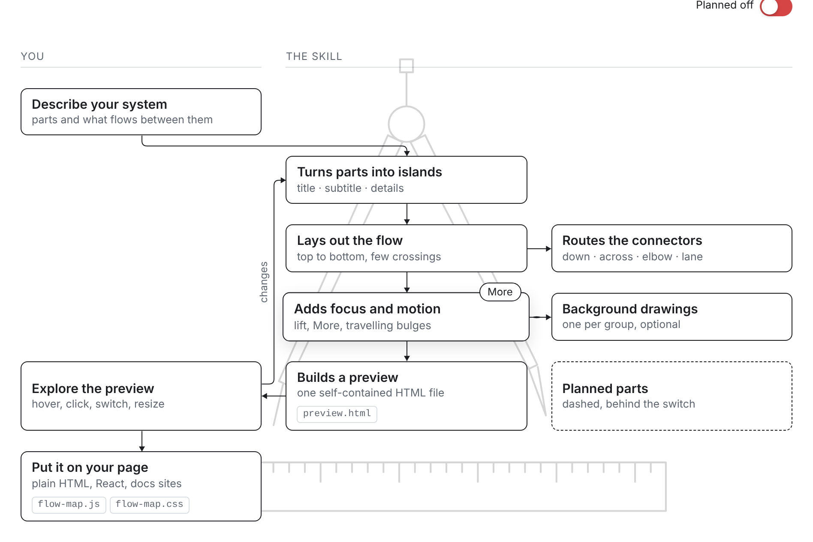

# Interactive flow diagram

An AI skill that turns a description of a software or hardware system into an explorable flow diagram for a web page: islands with hover focus and detail windows, crossing-free connectors with animated flow, a switch for planned parts, and optional background drawings. It works in light and dark mode and on phones, and needs no libraries.

**[Open the interactive guide](https://Vincentrindt05.github.io/interactive-flow-diagram/)**: it is built with the skill itself and explains every step and feature; hover an island and press More.

## Install

The skill is the folder `interactive-flow-diagram/` (with `SKILL.md` inside). It uses the open `SKILL.md` format, so the same folder works in several apps.

- **Claude (app):** zip the folder and upload it in the Skills section of your settings.
- **Claude Code:** copy the folder to `~/.claude/skills/`.
- **ChatGPT:** zip the folder and upload it under Plugins → Skills → Create (paid plans).
- **Codex:** copy the folder to `~/.agents/skills/`.

Menu names change from time to time; if one is not where this says, look for "Skills" in the app's settings or documentation.

## Use

Describe your system and ask for an interactive diagram, for example:

> Make an interactive flow diagram of our order pipeline: the shop sends an order to the payment service, which confirms it; the warehouse picks and packs, then shipping books a courier and sends the tracking link back to the shop. Shipping by drone is planned.

You get one HTML file to try in the browser. Ask for changes in plain words, then put the two engine files and your config on your site (see `interactive-flow-diagram/references/config.md`).

## Contents

| path | what it is |
|---|---|
| `interactive-flow-diagram/SKILL.md` | the instructions the assistant follows |
| `interactive-flow-diagram/assets/` | the engine (`flow-map.js`, `flow-map.css`) and the page template |
| `interactive-flow-diagram/scripts/` | `build_standalone.py` (one-file preview), `compact_svg.py` (background drawings) |
| `interactive-flow-diagram/references/config.md` | every config option, theming, embedding |
| `interactive-flow-diagram/examples/guide.config.js` | the guide's config, a complete example |
| `docs/` | the built guide for GitHub Pages |

To publish the guide: in the repository settings, enable GitHub Pages from the `docs` folder of the main branch.

## License

MIT, see `LICENSE`.
